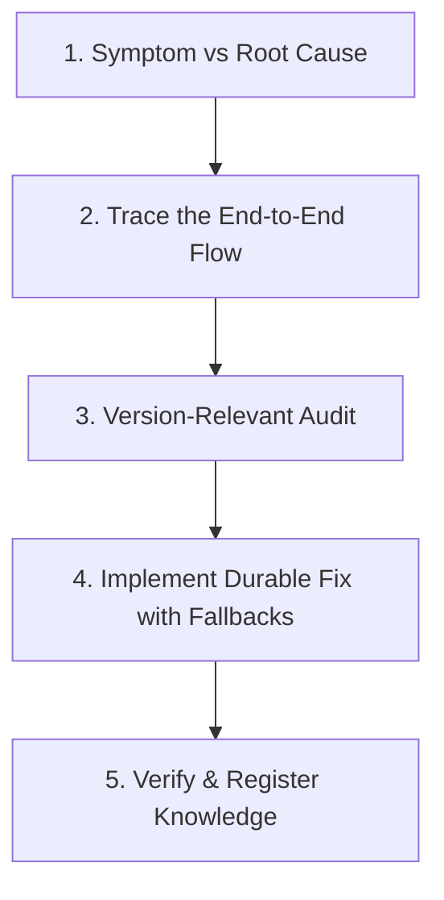

# Durable & Systemic Problem-Solving Guide

This skill encodes the engineering standard for diagnosing, solving, and verifying problems across the Heeyaku codebase. When diagnosing a bug or adding a feature, **never apply a localized, fragile patch**. Always see the **bigger picture**, ensure the solution is **version-relevant**, and build for **long-term stability**.

---

## 1. The 5-Phase Systemic Workflow

### Phase 1: Distinguish Symptom from Root Cause
- An error message (e.g. "Missing Clerk Secret Key", "Redirection loop", "Button does nothing") is merely a **symptom**.
- Ask **"Why?" five times**:
  - *Why did the button do nothing?* -> The server action failed.
  - *Why did the action fail?* -> `clerkClient()` threw missing key error.
  - *Why did it throw?* -> `@clerk/nextjs` server context was uninitialized in the action.
  - *Why did the user see nothing?* -> The form only showed error banner if `otpState.sent === true`, and no toast was dispatched.
- **Rule:** A fix is only complete when **both** the backend root cause AND the frontend feedback/fallback UX are addressed.

### Phase 2: Trace the End-to-End Lifecycle
Always examine the entire pipeline across layers:
1. **Client UI & Form State:** Disabled buttons, loading spinners, input validation, error banners, toast notifications.
2. **Client-Side Auth / SDK:** Token storage, active sessions, client component hydration (`<Show>`, `<SignIn>`).
3. **Routing & Proxy Layer:** Next.js 16 `proxy.ts`, route matchers, `clerkMiddleware()`, URL parameter preservation.
4. **Server Actions & Route Handlers:** RBAC assertions, payload sanitization, error boundaries, transaction handling.
5. **Domain Services:** Resilient third-party clients, database queries via Prisma, retry policies.
6. **Infrastructure:** Oracle Cloud PostgreSQL 18, PgBouncer pooling (port 6432 vs 5432), environment variables.

### Phase 3: Version-Relevant Architecture Checks
Never use outdated conventions from legacy tutorials or older Next.js/Clerk versions. Always verify against the installed versions in `package.json`:

| Package | Installed Version | Current Modern Conventions & Breaking Changes |
| :--- | :--- | :--- |
| **Next.js** | `16.3.4` (Next 16) | • `proxy.ts` replaces `middleware.ts` (Next 16 convention) • Dynamic request APIs are strictly async (`await auth()`, `await cookies()`, `await headers()`) • Server actions require explicit auth checks (`assertAuthenticatedUser()`) • Verify breaking changes in `node_modules/next/dist/docs/` |
| **Clerk** | `@clerk/nextjs 7.9.4` & `@clerk/backend` | • Clerk Core 3: `<SignedIn>` / `<SignedOut>` deprecated; use `<Show when="signed-in">` • Use `createClerkClient({ secretKey, publishableKey })` for backend services and background scripts • Error payloads use `long_message` (snake_case), not `longMessage` • Verification status lives under `verification.status` • Never hardcode production host headers (`heeyaku.vercel.app`) in development proxy |
| **React** | `19.2.8` (React 19) | • Native async transitions, action hooks, no `findDOMNode` • Ref as a prop (no `forwardRef` required) |
| **Database** | Prisma `6.19.3` + PgBouncer | • Transactions and migrations use `DIRECT_URL` (port 5432) • Pooled queries use `DATABASE_URL` with `?pgbouncer=true` (port 6432) |

### Phase 4: Build for Durability (Prevent Long-Term Regressions)
1. **Defense in Depth & Graceful Fallbacks:**
   - If an async context lookup (like `currentUser()`) can fail or timeout, provide a direct fallback (e.g. `createClerkClient().users.getUser(userId)`).
   - If a URL redirect parameter can be an absolute same-origin URL (e.g. `http://localhost:3000/admin/employees`), sanitize and extract the relative path rather than blindly rejecting it.
2. **Never Swallow Errors Silently:**
   - Every server action must return a typed `ActionResponse<T> = { success: boolean; data?: T; error?: string }`.
   - Client callers must notify users immediately via `toast.error(res.error)` AND display accessible error banners.
3. **Environment Isolation:**
   - Development (`NODE_ENV === 'local' | 'development'`) must NEVER proxy or mock production domains (`heeyaku.vercel.app`) unless explicitly intended.
   - Separate test keys (`pk_test_...`) from production keys (`pk_live_...`).

### Phase 5: Verification Checklist Before Concluding
Before telling the user a fix is done, execute this 4-point audit:
- [ ] **Typecheck:** Run `npx tsc --noEmit` and confirm 0 errors.
- [ ] **Upstream/Downstream Impact:** Did the change in service `A` break caller `B` or page `C`?
- [ ] **User Feedback Loop:** If an error occurs now, will the user see an informative message?
- [ ] **Clean Up:** Delete any scratch debug scripts (`scripts/test-*.ts`) or temporary files.

---

## 2. Common Architectural Anti-Patterns & Solutions

### Anti-Pattern 1: The Localized Patch
- ❌ **Wrong:** Wrapping a broken function in a silent `try { ... } catch {}` so it doesn't crash, leaving the user with an unresponsive button.
- ✅ **Right:** Identify why the function threw, fix the root dependency, and provide an explicit fallback with user notification.

### Anti-Pattern 2: Hardcoded Production Environment in Proxy
- ❌ **Wrong:** Rewriting `localhost` headers to `heeyaku.vercel.app` in `proxy.ts`, which breaks test session cookies and causes redirect loops.
- ✅ **Right:** Guard reverse proxy logic with `process.env.NODE_ENV === 'production' && process.env.NEXT_PUBLIC_CLERK_PROXY_URL`.

### Anti-Pattern 3: Fragile Open-Redirect Sanitizer
- ❌ **Wrong:** Rejecting any redirect URL containing `:` or `http`, which turns `http://localhost:3000/admin/employees` into a loop to `/admin/dashboard`.
- ✅ **Right:** Parse same-origin URLs via `new URL(trimmed)` and safely extract `url.pathname + url.search`.

### Anti-Pattern 4: Hard-Coded `forceRedirectUrl` on Auth Modals
- ❌ **Wrong:** Setting `forceRedirectUrl` on `<SignIn>` or `<SignUp>` components, which forcibly overrides Clerk's `?redirect_url=...` query parameter and bounces the user to an unintended page.
- ✅ **Right:** Use `fallbackRedirectUrl` so Clerk preserves and honors the user's requested destination.

### Anti-Pattern 5: Intermediary Double-Hop Role Redirects
- ❌ **Wrong:** Route A blocks a role and redirects to Route B (`/admin/dashboard`), and Route B immediately blocks that role and redirects to Route C (`/admin/employees`), causing a multi-hop bounce.
- ✅ **Right:** Inspect the user's role and redirect directly to their primary authorized destination (`admin.role === Role.HR ? '/admin/employees' : '/admin/dashboard'`).

### Anti-Pattern 6: Calling `await clerkClient()` in Server Actions Without Context
- ❌ **Wrong:** Relying on `@clerk/nextjs/server`'s `clerkClient()` in Server Actions or background scripts, which throws `Missing Clerk Secret Key` when request storage is unattached.
- ✅ **Right:** Use `createClerkClient({ secretKey, publishableKey })` from `@clerk/backend` for 100% reliable domain service synchronization.
