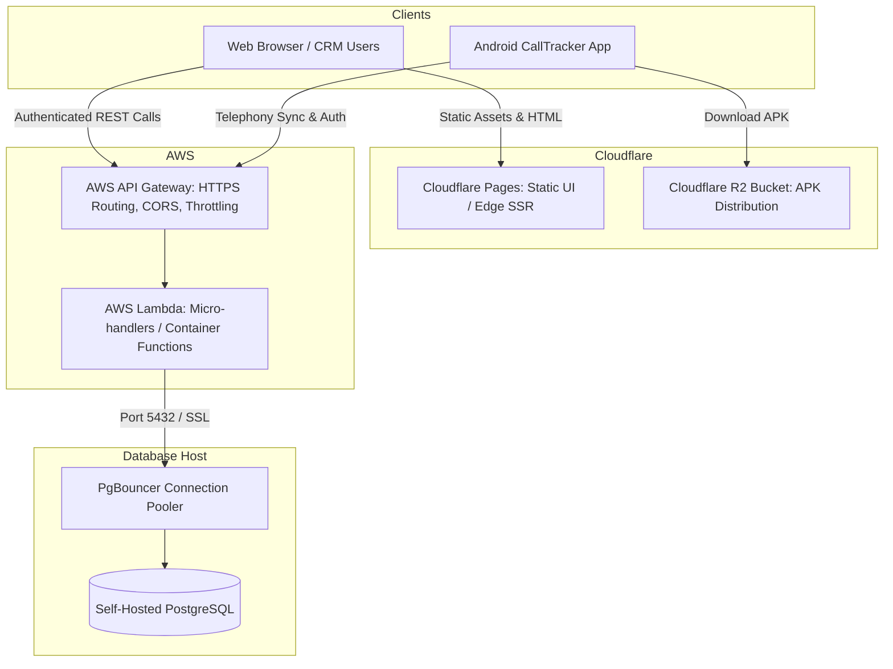

# HEEYAKU — Production Architecture & Audit Reports (Stages 1 – 5)

This directory contains the authoritative documentation, security audits, verification reports, and target migration architectures for the HEEYAKU CRM and Telephony platform across Stages 1 through 5.

---

## 📚 Master Index of Reports

| Report Document | Stage & Scope | Core Topics Covered | Status |
| :--- | :--- | :--- | :---: |
| [**Stage 1: Multi-Tenant Architecture & Governance**](file:///c:/Users/sibas/OneDrive/Desktop/Heeyaku%20Project/heeyaku/reports/STAGE_1_MULTI_TENANT_ARCHITECTURE_REPORT.md) | **Stage 1** | Multi-tenant domain model, role-based access control (CEO, HR, TL, BDA), tenant isolation, BDA seat quotas, company suspension kill-switch, Clerk auth sync. | **VERIFIED** |
| [**Stage 2: Telephony CRM & Mobile Application**](file:///c:/Users/sibas/OneDrive/Desktop/Heeyaku%20Project/heeyaku/reports/STAGE_2_TELEPHONY_CRM_MOBILE_REPORT.md) | **Stage 2** | Android React Native/Kotlin CallTracker, hardware telephony listeners, offline SQLite FIFO queue, device-bound HMAC-SHA256 JWTs, Clerk email OTP, call outcome modal. | **VERIFIED** |
| [**Stage 3: Lead Pipeline & Integrations**](file:///c:/Users/sibas/OneDrive/Desktop/Heeyaku%20Project/heeyaku/reports/STAGE_3_LEAD_PIPELINE_INTEGRATIONS_REPORT.md) | **Stage 3** | External API lead ingestion, Google Sheets two-way sync, connected-call KPI disposition gating (talk time > 0s), prospect promotion, cross-squad transfer, ExcelJS/PapaParse export. | **VERIFIED** |
| [**Stage 4: Production Hardening & Security**](file:///c:/Users/sibas/OneDrive/Desktop/Heeyaku%20Project/heeyaku/reports/STAGE_4_PRODUCTION_HARDENING_VERIFICATION_REPORT.md) | **Stage 4** | Complete synthesis of Stages 4.1 – 4.8.4: CWE-209 sanitization, ingress anti-spoofing, distributed rate limiting with $0 in-memory fallback, timing-safe nonce purge, 5-layer restore isolation, off-server AES-256 replication. | **VERIFIED** |
| [**Stage 4.8.3 & 4.8.4 Deployment & Release Gate**](file:///c:/Users/sibas/OneDrive/Desktop/Heeyaku%20Project/heeyaku/reports/STAGE_4_8_3_REPORT.md) | **Stage 4.8.3 / 4.8.4** | Detailed deployment ingress configuration, Vercel cron registration, backup & recovery runbooks, automated test outputs, and operator release checklist. | **PARTIAL** (Pending Operator Actions) |
| [**Stage 4.8.5: Operational Release Gate Closure**](file:///c:/Users/sibas/OneDrive/Desktop/Heeyaku%20Project/heeyaku/reports/STAGE_4_8_5_OPERATIONAL_RELEASE_GATE_CLOSURE_REPORT.md) | **Stage 4.8.5** | Assessment of code/debugging completeness, 5-layer restore drill safety, and exact runbook for the 3 remaining operator steps. | **PARTIAL** (Pending Operator Actions) |
| [**Stage 5: Decoupled Architecture Migration Plan**](file:///c:/Users/sibas/OneDrive/Desktop/Heeyaku%20Project/heeyaku/reports/STAGE_5_DECOUPLED_ARCHITECTURE_MIGRATION_PLAN.md) | **Stage 5 (Target)** | Cloudflare Pages (Frontend) + AWS API Gateway / Lambda (Backend) migration plan, converting 52 Server Actions & 15 API routes, PgBouncer setup, Clerk auth, and Cloudflare R2 APK distribution. | **ARCHITECTED** (Ready for Execution) |

---

## 🛡️ Current vs. Target Deployment Architecture

### Current Deployment (Stage 4)
- **Monolith:** Next.js 16.4.2 App Router on Vercel Edge/Serverless.
- **Database:** Self-Hosted PostgreSQL server.
- **Mobile:** React Native / Kotlin app calling Vercel `/api/employee/*`.
- **Scheduled Jobs:** Vercel Cron invoking `/api/cron/cleanup-nonces`.

### Target Decoupled Deployment (Stage 5)

---

## 🚀 Pre-Production Operator Checklist

To transition the release gate from **PARTIAL** to **PASS**, execute the 3 operational steps detailed in [Stage 4.8.5 Report Section 3](file:///c:/Users/sibas/OneDrive/Desktop/Heeyaku%20Project/heeyaku/reports/STAGE_4_8_5_OPERATIONAL_RELEASE_GATE_CLOSURE_REPORT.md#3-operator-execution-runbook):
1. **Set `CRON_SECRET`:** Add the variable in Vercel Project Settings > Environment Variables.
2. **Run Restore Drill:** Execute `./scripts/restore-drill.sh <DUMP_PATH> heeyaku_drill_temp` on the PostgreSQL server.
3. **Configure Offsite Backup:** Configure `R2_BACKUP_BUCKET` and `BACKUP_ENCRYPTION_KEY` on the database server.
