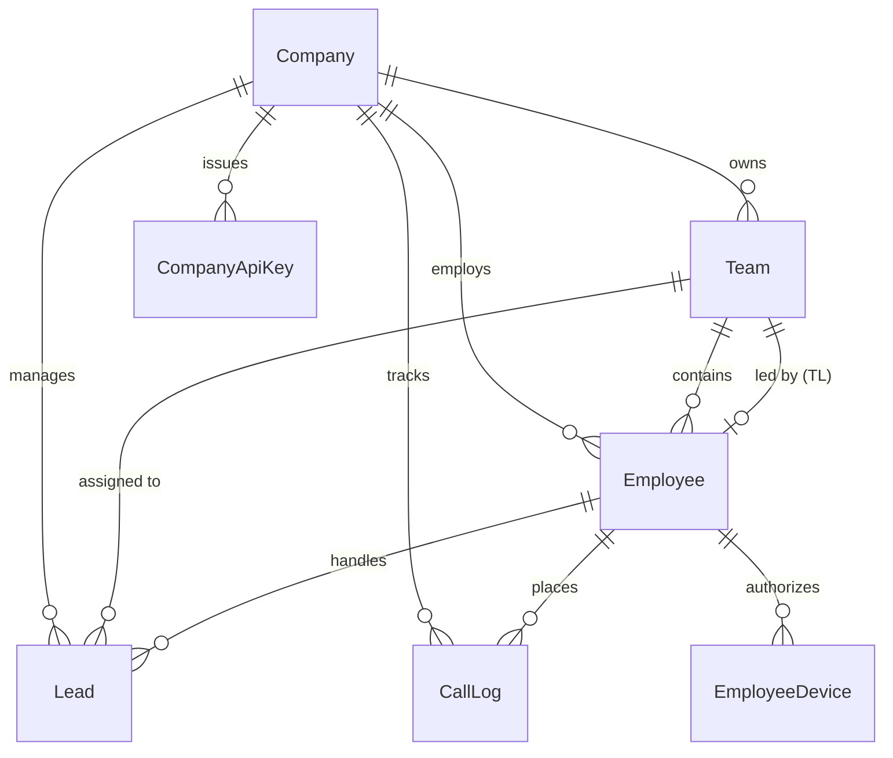

# HEEYAKU — Stage 1: Core Foundation & Multi-Tenant Architecture Report

**Stage:** Stage 1  
**Domain:** Multi-Tenant Core, Organization Hierarchy, Governance & Authentication  
**Status:** COMPLETE & PRODUCTION-VERIFIED  
**Architecture:** Next.js 16 App Router, Prisma ORM 6.19.3, PostgreSQL, Clerk Authentication  

---

## 1. Executive Summary

Stage 1 established the bedrock architectural foundation of the HEEYAKU multi-tenant CRM platform. It implemented a strict, non-bypassable organizational data hierarchy separating individual companies (tenants), squads/teams, employees, and roles, integrated with Clerk identity management and fine-grained Role-Based Access Control (RBAC).

All tenant boundaries are enforced at the database and service layer, ensuring complete data isolation, quota enforcement, and tenant-lifecycle management (activation, trial expiration, and administrative suspension).

---

## 2. Multi-Tenant Domain Model & Hierarchy

The relational data model guarantees that every business entity is scoped to a specific `companyId`.

### Core Database Entities ([`prisma/schema.prisma`](file:///c:/Users/sibas/OneDrive/Desktop/Heeyaku Project/heeyaku/prisma/schema.prisma))
1. **Company (`companies` table):**
   - Unique identifier (`cuid`) and URL-safe `slug`.
   - `status`: `PENDING_VERIFICATION`, `ACTIVE`, `REJECTED`, `SUSPENDED_BY_ADMIN`.
   - Seat control: `maxBdas` (maximum authorized active BDA seats) and `requestedBdas`.
   - Lifecycle timestamps: `trialEndsAt`, `verifiedAt`, `suspendedAt`, `suspendReason`.
2. **Team / Squad (`teams` table):**
   - Squad grouping with `name`, `colorTag`, and `teamLeadId`.
   - Scoped strictly to `companyId` with cascade deletion protection.
3. **Employee (`employees` table):**
   - Unique `employeeCode` (e.g. `ZYR-BDA-001`) and `email`.
   - `role`: `CEO`, `HR`, `TEAM_LEAD`, `BDA`.
   - Integration linkage: `clerkUserId` (Clerk Web identity) and `passwordHash` (for mobile telephony app).
   - Seat tracking: `isActive` flag.
4. **Employee Device (`employee_devices` table):**
   - Bi-unique `[employeeId, deviceId]` constraint tracking verified mobile hardware.

---

## 3. Role-Based Access Control (RBAC) Matrix

HEEYAKU enforces strict vertical and horizontal authorization boundaries implemented in [`lib/auth/rbac.ts`](file:///c:/Users/sibas/OneDrive/Desktop/Heeyaku Project/heeyaku/lib/auth/rbac.ts).

| Operational Domain | Super Admin (Platform) | CEO (Tenant) | HR (Tenant) | Team Lead (Tenant Squad) | BDA (Sales Agent) |
| :--- | :---: | :---: | :---: | :---: | :---: |
| **Tenant Verification & Suspension** | FULL | READ-ONLY | DENIED | DENIED | DENIED |
| **Company BDA Seat Quotas** | FULL | REQUEST-ONLY | DENIED | DENIED | DENIED |
| **All Company Leads CRM** | FULL | FULL | DENIED | SQUAD-ONLY | ASSIGNED-ONLY |
| **Lead Export (XLSX/CSV)** | FULL | FULL | DENIED | SQUAD-ONLY | DENIED |
| **Staff & Team Management** | FULL | FULL | FULL | VIEW-ONLY | DENIED |
| **Telephony Analytics & Dashboard** | FULL | FULL | LIMITED | SQUAD-ONLY | PERSONAL-ONLY |
| **Android CallTracker App** | DENIED | DENIED | DENIED | DENIED | FULL |

### Key RBAC Invariants
- **CEO:** Possesses omni-privilege over tenant business data, analytics, export, and employee accounts. Blocked from other tenants and cross-tenant Super Admin functions.
- **HR:** Scoped strictly to employee onboarding, roster management, and team assignments. Strictly blocked from viewing or exporting sales leads.
- **Team Lead:** Scoped to their specific squad. Can reassign leads within the squad and convert prospects.
- **BDA:** Scoped exclusively to leads assigned to them. Zero access to the web administration portal; authorized exclusively on the Android Telephony app.

---

## 4. Tenant Lifecycle & Suspension Kill-Switch

1. **Administrative Kill-Switch:**
   - When a company status is set to `SUSPENDED_BY_ADMIN` or `REJECTED`, all employee sessions are immediately invalidated.
   - Mobile authentication requests from suspended companies are rejected with HTTP 403 Forbidden (`COMPANY_SUSPENDED`).
2. **BDA Seat Quota Enforcement ([`lib/employee/employee.service.ts`](file:///c:/Users/sibas/OneDrive/Desktop/Heeyaku Project/heeyaku/lib/employee/employee.service.ts)):**
   - Prior to activating a new BDA account or switching an existing employee to `BDA`, the service calculates active BDA counts against `company.maxBdas`.
   - Exceeding the quota throws a descriptive `QuotaExceededError`, preventing unauthorized agent provisioning.
3. **Super Admin Isolation ([`lib/auth/rbac.ts`](file:///c:/Users/sibas/OneDrive/Desktop/Heeyaku Project/heeyaku/lib/auth/rbac.ts)):**
   - Super Admin identity is verified via environment-controlled email allowlists and Clerk metadata.
   - Cross-tenant leakage is prevented: Super Admin operations are isolated from individual tenant business pipelines.

---

## 5. Verification & Test Evidence

Stage 1 multi-tenant governance was validated using automated regression suites:
- **Suite Command:** `npx tsx scripts/test-multi-tenant-governance.ts`
- **Results:**
  - Multi-tenant data segregation: **VERIFIED** (0 cross-tenant data leaks).
  - BDA seat quota enforcement: **VERIFIED** (Blocked at maxBdas limit).
  - Suspension kill-switch: **VERIFIED** (Immediate lockout upon suspension).
  - RBAC privilege escalation prevention: **VERIFIED** (HR denied leads access; BDA denied web admin access).
