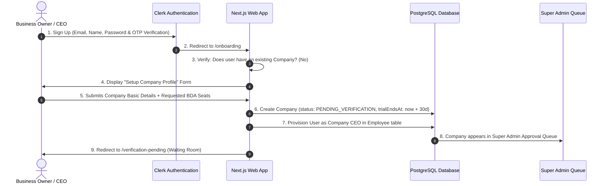

# HEEYAKU Super Admin & Multi-Tenant Architecture Specification

**Status:** APPROVED ARCHITECTURAL BLUEPRINT (FINE-TUNED & OPTIMIZED)  
**Target Version:** Next.js 16.3.4 (Turbopack, React 19) · Prisma 6 · PostgreSQL 18 & PgBouncer  
**Design Philosophy:** Maximum Practical Control · Strict Fail-Closed Security · Zero Over-Engineering  

---

## 1. Executive Summary & Topology

The platform evolves from a single-tenant sales CRM into a scalable **Multi-Tenant B2B SaaS Platform** governed by an **App-Level Super Admin (Platform Owner)**.

```
                         ┌────────────────────────────────────────────────────────┐
                         │           SUPER ADMIN PORTAL (/super-admin)            │
                         │   • Master Email Allowlist in .env (SUPER_ADMIN_EMAILS)│
                         │   • 1-Click Master Company Kill-Switch (0ms lockdown)  │
                         │   • Pending Verification & Approval Queue              │
                         │   • BDA Seat Limits & 30-Day Trial Expiry Control      │
                         │   • Ghost Mode Impersonation ("View as CEO")           │
                         │   • Global System Announcement Broadcast               │
                         └───────────────────────────┬────────────────────────────┘
                                                     │
                     ┌───────────────────────────────┴───────────────────────────────┐
                     ▼                                                               ▼
        ┌─────────────────────────┐                                     ┌─────────────────────────┐
        │   COMPANY WORKSPACE A   │                                     │   COMPANY WORKSPACE B   │
        │ • Status: ACTIVE        │                                     │ • Status: SUSPENDED     │
        │ • 8 / 10 BDAs Used      │                                     │ • Web & Mobile Blocked  │
        │ • 30-Day Trial: 18d left│                                     │ • 403 Forbidden on API  │
        └────────────┬────────────┘                                     └─────────────────────────┘
                     │
       ┌─────────────┴─────────────┐
       ▼                           ▼
[Web Admin Portal]       [Android Mobile App]
CEO, HR, Team Leads      BDAs / Callers (REST APIs)
```

---

## 2. Role Hierarchy & Access Boundaries

| Role | Defined By | Authentication | Responsibilities | Scope |
|---|---|---|---|---|
| **App-Level Super Admin** | `SUPER_ADMIN_EMAILS` in `.env` | Clerk Session matching allowlist | Platform governance, company approval/rejection, master kill-switch, seat tuning, trial extensions, ghost mode. | **Global (All Tenants)** |
| **Company Admin (CEO)** | Created during company registration | Clerk Session + PostgreSQL `Employee` (`role = CEO`) | Internal squad formation, lead assignment, team targets, importing leads, hiring HR/TL/BDAs. | **Single Company Only** |
| **Human Resources (HR)** | Created by CEO | Clerk Session + PostgreSQL `Employee` (`role = HR`) | Managing employee rosters, onboarding staff, viewing squad assignments. Blocked from customer lead PII. | **Single Company Only** |
| **Team Lead (TL)** | Assigned by CEO/HR | Clerk Session + PostgreSQL `Employee` (`role = TEAM_LEAD`) | Managing assigned squad BDAs, distributing squad leads, viewing squad leaderboards. | **Assigned Squad Only** |
| **Business Dev Associate (BDA)** | Created by CEO/HR | Mobile Bearer JWT (`HS256`) + DB resolution | Telephony outreach via Android mobile app, call dispositioning, lead updates. Consumes 1 paid caller seat. | **Assigned Leads Only** |

---

## 3. Company Registration & Onboarding Lifecycle

### 3.1 Flow Diagram



### 3.2 Registration Data Fields
When a user finishes email verification, `/onboarding` collects:
1. **Company Name** *(Required, e.g. "Apex EdTech Pvt Ltd")*
2. **Workspace Slug** *(Auto-slugified, editable, unique, e.g. `apex-edtech`)*
3. **Official Contact Phone** *(Required, for administrative contact)*
4. **Industry / Domain** *(Dropdown: EdTech, Logistics, Real Estate, Healthcare, B2B Services, Other)*
5. **Requested BDA Seats** *(Dropdown: 5, 10, 20, 50, or custom caller count)*

### 3.3 The CEO "Waiting Room" Screen (`/verification-pending`)
Until the Super Admin approves the company, the CEO cannot access `/admin/dashboard`, import leads, or create staff:
* Professional status panel:
  * Company Name & Unique Reference ID (`CMP-XXXXX`)
  * Status badge: `⏳ Under Platform Review`
  * Explanatory text: *"Your company workspace has been registered and is currently under review by the Heeyaku platform administration team. Access will be activated upon verification."*
  * Typical approval timeframe: *"Within 2–4 hours"*
  * Platform support contact: `platform-admin@heeyaku.com`
  * `[ Refresh Status ]` button to check if approved without re-logging.

---

## 4. Super Admin Portal (`/super-admin`)

### 4.1 Security & Route Matcher
* **Path:** `/super-admin(.*)`
* **Guard:** Strictly verified at edge middleware and server level against `SUPER_ADMIN_EMAILS` (comma-separated list in `.env`).
* **Fail-Closed:** Any user whose email is not on the list receives an immediate `404 Not Found` (concealing the route's existence) or `403 Access Denied`.

### 4.2 Pending Verifications Queue
A dedicated review queue displaying newly registered companies:
* **Table Columns:** Company Name, Slug, Contact Phone, Industry, CEO Email, **Requested BDA Seats**, Registration Date.
* **Actions:**
  * **`[ ✅ Approve & Activate ]`:**
    * Modal opens allowing Super Admin to confirm or adjust approved `maxBdas` (seats) and trial duration.
    * Updates `status = ACTIVE`, sets `verifiedAt = now()`, `verifiedBy = superAdminEmail`.
    * CEO workspace unlocks immediately.
  * **`[ ❌ Reject Application ]`:**
    * Prompts for an optional rejection reason.
    * Sets `status = REJECTED`.

### 4.3 Active Company Management Directory (Clean UI with Quick Drawer)
Instead of 5 clunky buttons cluttering each table row, the table displays essential information, a 1-click toggle, and a sleek **Manage Drawer**:

| Company | CEO / Contact | BDA Seats | Trial Status | Status Toggle | Actions |
|---|---|:---:|---|:---:|:---:|
| **Apex EdTech** | `ceo@apex.com`<br>`+91 98765 43210` | `8 / 10` | `18 days left` | `[ Toggle: Active ]` | `[ Manage ]` |
| **Zenith Infra** | `rahul@zenith.in`<br>`+91 91234 56789` | `4 / 5` | `3 days left` (Amber) | `[ Toggle: Active ]` | `[ Manage ]` |

#### The `[ Manage ]` Side Drawer
Clicking "Manage" opens a clean slide-over drawer containing:
1. **Seat Limit Stepper:** `[ - ] 10 BDAs [ + ]` (Adjust caller cap with instant save).
2. **Trial Extension:** Quick buttons: `[ +15 Days ]` and `[ +30 Days ]`.
3. **Ghost Mode Impersonation:** `[ 👁️ View as CEO ]` button.
4. **Cleanup Action:** `[ 🗑️ Delete Company ]` (prompts: *"Type company name to confirm deletion"*—cascades and clears dummy/test accounts).

---

## 5. The 1-Click Master Kill-Switch (0ms Lockdown)

### 5.1 Architecture: Centralized in Two Gates (Zero Redundant Code)
Rather than writing four separate enforcement modules across dozens of files, the kill-switch operates through **two single-point gates**:

```
Super Admin flips toggle ➔ DB updated (adminStatus = SUSPENDED_BY_ADMIN)
                             │
            ┌────────────────┴────────────────┐
            ▼                                 ▼
   [Gate 1: Web & Server Actions]    [Gate 2: Mobile Telephony]
   lib/auth/rbac.ts                  lib/employee/resolve.ts
   (Single 3-line check)             (Single 3-line check)
```

1. **Gate 1 (Web & Server Actions in [`lib/auth/rbac.ts`](file:///c:/Users/sibas/OneDrive/Desktop/Heeyaku%20Project/heeyaku/lib/auth/rbac.ts)):**  
   Every web route and Server Action calls `getAuthenticatedUser()` / `assertAuthenticatedUser()`. We add:
   ```typescript
   if (dbEmployee?.company?.status === 'SUSPENDED_BY_ADMIN') {
     throw new AuthorizationError('Workspace suspended by platform administrator.', 403);
   }
   ```
   * Result: Immediate redirect to `/workspace-suspended`. 100% of web pages and mutations are protected.
2. **Gate 2 (Mobile Telephony in [`lib/employee/resolve.ts`](file:///c:/Users/sibas/OneDrive/Desktop/Heeyaku%20Project/heeyaku/lib/employee/resolve.ts)):**  
   Every mobile API (`/api/employee/calls/sync`, `/leads`, `/auth`) calls `resolveEmployeeIdentity()`. We add:
   ```typescript
   if (employee?.company?.status === 'SUSPENDED_BY_ADMIN') {
     return null; // Triggers instant 403 { code: 'WORKSPACE_SUSPENDED' }
   }
   ```
   * Result: Android dialer cleanly pauses sync without crashing.

---

## 6. Commercial & Operational Controls (Zero Over-Engineering)

### 6.1 30-Day Trial Engine (Zero Cron Jobs)
* **Automatic Expiration Check:** Pure runtime date comparison (No background cron jobs or message queues):
  ```typescript
  const isTrialExpired = company.trialEndsAt && new Date() > company.trialEndsAt;
  ```
* **CEO Top Navbar Trial Pill:**  
  Inside `/admin/*`, the top navbar shows a subtle indicator:
  * $\ge 6$ days left: `✨ 30-Day Trial (18 days left)`
  * $\le 5$ days left (Amber warning): `⚠️ Trial ends in 3 days — Contact Sales to Upgrade`
* **Friendly "Trial Concluded" Screen (Distinct from Suspended):**  
  If the trial elapses, the CEO sees a polite, high-converting upgrade page instead of an accusatory suspension message:
  > 🚀 **Your 30-Day Heeyaku Trial Has Concluded**  
  > *We hope your sales team loved using the dialer! All your leads, call logs, and employee accounts are securely preserved.*  
  > `[ Contact Platform Sales to Activate Plan ]` · `sales@heeyaku.com`

### 6.2 Caller Seat Limits (`maxBdas`)
* **Telecallers Only:** Charged per caller seat (`maxBdas`). CEO and HR accounts are included for free and do not consume caller licenses.
* **Enforced at Creation in [`CreateEmployeeDialog`](file:///c:/Users/sibas/OneDrive/Desktop/Heeyaku%20Project/heeyaku/components/admin/employees/CreateEmployeeDialog.tsx):**
  ```typescript
  if (role === 'BDA') {
    const currentBdas = await prisma.employee.count({
      where: { companyId: user.companyId, isActive: true, role: 'BDA' }
    });
    if (currentBdas >= company.maxBdas) {
      return { success: false, error: `Caller seat limit reached (${company.maxBdas} BDAs). Contact platform manager to add more seats.` };
    }
  }
  ```

### 6.3 Soft-Queue Ingestion During Suspension
* If a company runs Facebook Lead Ads or Google Sheet sync and their trial ends:
  * Instead of returning `403` (which can cause Facebook to disconnect the webhook), `/api/v1/leads/ingest` still records the lead with:
    `status: NEW`, `notes: "[Captured during trial hold]"`
  * Callers cannot dial or export them until the CEO upgrades, giving the CEO an immediate incentive:  
    *"You have 45 new customer leads waiting—upgrade now to unlock outreach!"*

### 6.4 "Login As Company" (Ghost Mode / Impersonation)
* Super Admin clicks `[ 👁️ View as CEO ]` in the Manage drawer.
* Sets an encrypted, short-lived cookie `heeyaku_impersonate_company_id`.
* The Super Admin instantly views that company's exact dashboard and squads to troubleshoot issues without asking for passwords.
* Floating amber top bar: `Viewing as Apex EdTech (Ghost Mode) — [ Exit Ghost Mode ]`.

### 6.5 Platform Announcement Banner
* Super Admin inputs text in `/super-admin`: e.g. *"Scheduled server maintenance tonight at 11:30 PM IST"* or *"New Android APK v1.2 is ready for download."*
* Displayed as an amber banner at the top of all tenant portals.

---

## 7. Database Schema Blueprint (`prisma/schema.prisma`)

```prisma
enum CompanyStatus {
  PENDING_VERIFICATION // Newly registered, awaiting Super Admin approval
  ACTIVE               // Approved & operational
  REJECTED             // Rejected by Super Admin
  SUSPENDED_BY_ADMIN   // Suspended via 1-Click Master Kill-Switch
}

model Company {
  id              String        @id @default(cuid())
  name            String
  slug            String        @unique
  phoneNumber     String?
  industry        String?
  status          CompanyStatus @default(PENDING_VERIFICATION)
  
  // Commercial Controls
  maxBdas         Int           @default(5)           // Approved BDA caller seat limit
  requestedBdas   Int           @default(5)           // Initial request from onboarding
  trialEndsAt     DateTime?                           // 30-day trial expiration timestamp
  
  // Verification & Audit Trail
  verifiedAt      DateTime?
  verifiedBy      String?                             // Super Admin email
  rejectionReason String?
  suspendedAt     DateTime?
  suspendReason   String?

  // Tenant Relations
  employees       Employee[]
  teams           Team[]
  leads           Lead[]
  callLogs        CallLog[]
  syncMeta        SyncMeta[]

  createdAt       DateTime      @default(now())
  updatedAt       DateTime      @updatedAt

  @@index([status])
  @@index([slug])
  @@map("companies")
}
```

### Foreign Key Links on Existing Models:
* **`Employee`**: `companyId String?`, `company Company? @relation(fields: [companyId], references: [id], onDelete: Cascade)`
* **`Team`**: `companyId String?`, `company Company? @relation(fields: [companyId], references: [id], onDelete: Cascade)`
* **`Lead`**: `companyId String?`, `company Company? @relation(fields: [companyId], references: [id], onDelete: Cascade)`
* **`CallLog`**: Linked via Employee and Lead relations.

---

## 8. Zero-Data-Loss Migration Plan

To ensure your existing leads, employees, teams, and call logs continue working seamlessly:
1. **Schema Migration:** Apply the `Company` model and foreign key columns.
2. **Seed Default Company:** In the migration script, automatically seed:
   ```typescript
   const defaultCompany = await prisma.company.upsert({
     where: { slug: 'heeyaku-primary' },
     update: {},
     create: {
       name: 'Heeyaku Primary',
       slug: 'heeyaku-primary',
       status: 'ACTIVE',
       maxBdas: 100,
       trialEndsAt: new Date('2030-01-01'), // Permanent for primary org
     }
   });
   ```
3. **Link Existing Data:** Update all existing `Employee`, `Team`, and `Lead` records to set `companyId = defaultCompany.id`.
4. **Result:** Existing workflows continue with 100% uptime and zero data alteration.

---

## 9. Performance & Optimization Integration

From the database audit, the following quick-fixes are integrated directly into this migration:
1. **Connection Pooling:** Change `connection_limit=1` to `connection_limit=15&pool_timeout=30` in `.env` and `.env.local` to eliminate pool starvation under concurrent queries.
2. **Bounded Mobile Queries:** Scope `/api/employee/calls/sync` queries strictly to the phone numbers in the incoming batch rather than loading all employee leads into Node memory.
3. **Atomic Lead Assignments:** Enforce atomic chunking with row guards to eliminate double-assignment race conditions.
